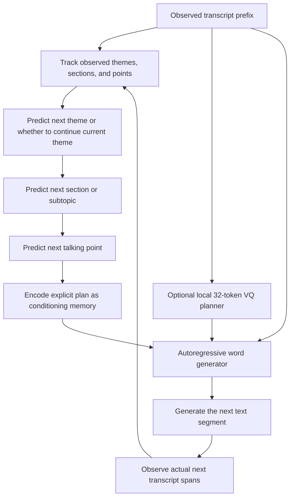

# Explicit hierarchical speech planner

## The idea in model terms

The speech plan has three human-readable levels:

1. **Theme:** a broad message that can span several parts of the speech.
2. **Section:** a contiguous passage developing a theme or subtopic.
3. **Talking point:** a specific claim, story, example, promise, attack, or mention within a section.

The exact phrases and words are the **surface wording**, generated after the semantic plan. These levels are distinct from SpeechPlan-H's existing VQ plan codes, which remain opaque learned representations.

## Intended in-speech path



The hierarchy gives two separate views of the same speech. **Before the speech**, the pre-speech task may predict the whole event-level outline from prior speeches and genuinely available event metadata. **During the speech**, the continuation task predicts only the next theme/section/point from the observed prefix and previously predicted plan nodes, then updates state after new transcript spans arrive. It must not read later nodes from the full gold outline. The word generator verbalizes the predicted node; it does not get to use future target text. Keep these evaluations separate.

The existing VQ planner can remain as a fine-grained wording aid. Its 1/4/16/32 codes must not be renamed as themes or ideas. The explicit hierarchy needs its own training targets and evaluation.

## Training data contract

A reviewed plan is stored separately from the source event and points back to target-speaker transcript turns. Each node has a short summary and supporting `turn_ids`; parent nodes include the turns covered by their children. Sibling points may share a turn when one source span contains multiple ideas. The event transcript remains the source of exact wording.

```json
{
  "schema_version": 1,
  "event_id": "sample-event",
  "review_status": "draft",
  "reviewed_by": null,
  "themes": [
    {
      "id": "theme-1",
      "summary": "Example broad theme",
      "turn_ids": ["sample-event:turn:0000", "sample-event:turn:0001"],
      "sections": [
        {
          "id": "section-1",
          "summary": "Example subtopic",
          "turn_ids": ["sample-event:turn:0000", "sample-event:turn:0001"],
          "talking_points": [
            {
              "id": "point-1",
              "summary": "Example claim or mention",
              "turn_ids": ["sample-event:turn:0000"]
            }
          ]
        }
      ]
    }
  ]
}
```

Only `review_status: "reviewed"` plans with a reviewer and valid target-speaker turn references are eligible for the reviewed semantic-training policy. AI-authored drafts are not human review or gold labels. Annotators should ground every node in the cited transcript turns, avoid inferring intent not stated in the transcript, and allow overlapping turn references when a source span contains multiple points. Two local blind copies of the 20-event pilot are available at `data/rollcall-plan-review-annotator-a.jsonl` and `data/rollcall-plan-review-annotator-b.jsonl`; both contain blank plans, not machine suggestions. Annotate independently, compare disagreements, then adjudicate. Their chronological hints are 16 train / 2 validation / 2 test events; this is only a schema/agreement pilot, not enough for model-quality claims. Keep the test events out of training. Do not train an explicit semantic hierarchy on automatically inferred adjacent spans or treat VQ codes as semantic labels.

## Evaluation boundaries

Evaluate theme, section, and talking-point prediction separately from exact wording. Split by whole event dates. For in-speech predictions, compare only plan nodes grounded in transcript spans that occur after the prediction point; do not expose those nodes or their text in the input. Keep this task separate from pre-speech forecasts and question-anchored response prediction.

## Explicit path model and label policies

`explicit-plan-train` trains a separate, from-scratch causal model that predicts one theme → section → talking-point path from an observed prefix. It supports three deliberately separate label policies:

- `reviewed` accepts only human-reviewed plans and is the route to semantic-plan evaluation.
- `weak-extractive` accepts only plans marked as drafts by the named labeler. It uses the highest-score Factba.se/IPTC source topic as the theme when present (otherwise whole-event keywords), fixed 15-target-turn keyword windows for sections, and fixed 3-turn keyword windows for talking points. IDF weights are computed only from the chronological training-date partition. These are real-transcript/source-metadata pseudo-labels; their scores measure reproduction of the labeling heuristic.
- `assistant-draft` accepts only drafts with the `assistant-excerpt-review-v1` source marker. The ignored `data/rollcall-assistant-plan-drafts.jsonl` pilot has 19 partial outlines based on selected transcript excerpts and one outline based on a full transcript. It is AI-authored, not human review or gold data; evaluation measures reproduction of these draft summaries only.

All policies split by whole event dates and exclude the target point's supporting turns from its transcript input. The current v2 decoder constrains marker order so every generated path follows the hierarchy grammar. Test metrics include token loss, teacher-forced token accuracy, and greedy exact-path match. Exact text match is not semantic idea accuracy. The model predicts the path only; it does not generate surface wording or condition SpeechPlan-H's decoder. Every run records its label policy, data hashes, and metrics; see `docs/model-versioning.md`.

The first real-transcript weak run used 1,200 events (954 train / 122 validation / 124 test; 36,479 / 4,323 / 4,533 path examples). The v2 diagnostic evaluation found full output collapse: across 4,533 test prefixes, the model produced one theme (`politics > human rights`) and one repeated section/point string (`going going going going`). Theme token F1 matched the training-majority baseline (0.316); section/point F1 (0.014 / 0.006) trailed a recent-prefix keyword baseline (0.090 / 0.037). All paths were structurally valid, with 36.7 ms p95 generation latency on CPU/4 threads (generation only; excludes tokenization and streaming). The model is fast enough for this prototype loop but not useful for prediction. These are weak-label diagnostics only.

The assistant-draft pilot trained version `speechplan-explicit/plan-path-v2/20261103T021125Z-d72efbdb` on 16 events / 60 paths and evaluated on 2 events / 22 paths; validation contained only 2 events / 4 paths. The test paths come from just two events and have inconsistent annotation granularity: one reused outline has 18 points, while the other is a partial excerpt draft. The ignored checkpoint is `checkpoints/explicit-plan-assistant-draft-pilot-001.pt`, with its report at `data/rollcall-assistant-plan-draft-pilot-evaluation.json`. The model again collapsed: theme and point predictions each had one unique output, section predictions had two, and lexical F1 and exact match were zero at all levels. The outputs were punctuation and repeated `and`; the recent-prefix keyword baselines scored 0.027 section F1 and 0.018 point F1. Grammar validity was 100%, with 18.8 ms p95 model-generation latency, excluding loading, tokenization, and streaming. This tiny test compares predictions with AI-authored draft summaries; it is a pipeline diagnostic, not semantic accuracy or evidence of deployment readiness. No human-reviewed semantic-plan run exists.
