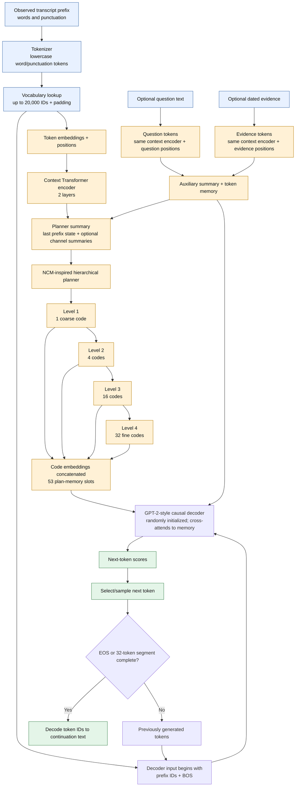
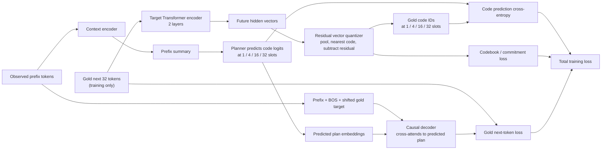
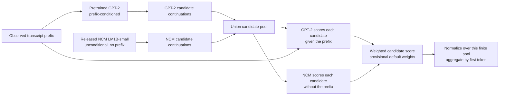

# SpeechPlan-H architecture flowchart

This page shows the model that was trained on the long-speech cohort. It is a small model trained from scratch: its decoder uses GPT-2 architecture, but it does **not** load GPT-2 weights or Stanford NCM weights.

## Prediction: observed text to next-token continuation

The plan is computed from the prefix and held fixed while the decoder generates one segment. Each of the four levels has a 128-entry codebook. Within a level, slot predictions are parallel; each finer level is conditioned on the coarser level. The 53 plan slots are learned latent vectors, not 53 words or named concepts. Training uses soft code distributions so gradients can flow; inference selects the highest-scoring code at each slot.

When a question or evidence input is absent, the model receives an empty-channel sentinel. In the long-speech run, the question and evidence channels contained no real question or evidence.

## Training: how the planner learns what codes to predict

The future target is available only as a training label. It is not an input to the planner at inference.

The implemented objective is `token loss + 0.25 × code-prediction loss + 0.05 × vector-quantization loss`. For the trained speech model, the vocabulary cap is 20,000, context length is 128 tokens, target length is 32 tokens, and the decoder has 4 layers, width 128, and 4 attention heads. The target encoder and quantizer create supervision; at prediction time, the planner must predict the codes from the observed prefix alone.

## Words, phrases, ideas, and “concepts”

| Level | What the implementation actually has |
|---|---|
| Words | A custom word-and-punctuation tokenizer maps text to vocabulary IDs. |
| Phrases | No separate phrase detector or phrase-planning module. The decoder learns token sequences and may reproduce phrase patterns implicitly. |
| Ideas | No human-labeled idea classifier or explicit idea-prediction output. |
| Concepts | The planner predicts discrete residual VQ code IDs at four time scales. They are learned representations, not readable concept labels, and a code is not guaranteed to represent one idea. |
| Output | A distribution over the next vocabulary token, followed by autoregressive token generation. |

So the actual path is **words → token IDs → learned hidden states and opaque multi-scale codes → next-word probabilities**. “Words → phrases → ideas → concepts” would suggest explicit semantic stages that this implementation does not contain. Adding a real idea layer would require reviewed idea labels, an explicit prediction head, and its own evaluation.

## Separate pretrained NCM + LLM comparison baseline

This is a different pipeline from SpeechPlan-H. It does not share weights with, or train jointly with, the model above.

This is proposal generation plus reranking, not a shared NCM-to-LLM neural network. NCM code likelihood and GPT-2 token likelihood use different scales; the default equal weights are not calibrated. The resulting first-token mass is only normalized over generated candidates, not over the full vocabulary.
